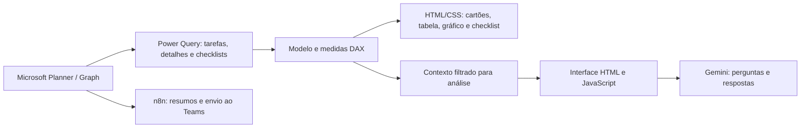

# Planner Analytics — Power BI, HTML e Gemini

Case de gestão de atividades que combina **Microsoft Planner, Microsoft Graph, medidas DAX que geram HTML/CSS e uma interface de análise assistida pelo Gemini**.

**Projeto complementar:** [resumos automatizados com n8n, Gemini e Teams](https://github.com/alosiolemos/n8n-planner-ai-teams-reports).

## O desafio

Consolidar atividades de Operações e Governança, apresentar backlog e entregas de forma clara e permitir perguntas sobre o contexto analisado. A solução também oferece detalhamento de tarefas e checklists.

Desenvolvi o painel e aproveitei a mesma fonte de dados e o processo de gestão em uma automação de relatórios. O compartilhamento é da fonte de dados e do processo de gestão; não foi identificada uma dependência obrigatória do n8n em relação ao dataset do Power BI.

## Arquitetura

O caminho Gemini documenta a implementação histórica. A chave real foi retirada; a interface não está conectada na distribuição pública.

## Conteúdo disponível

- **Oito medidas HTML completas**, revisadas para publicação.
- **23 medidas de suporte**, totalizando as 31 expressões do inventário.
- Esquema das tabelas e explicação dos relacionamentos.
- Contexto da interface Gemini e das limitações de renderização.
- Demonstração de dados fictícios e instruções de adaptação.
- Links para o fluxo n8n complementar.

| Medida | Código |
| --- | --- |
| Card_HTML | [Cartões de indicadores](dax/html/01-card.dax) |
| Tabela_HTML_Pro | [Tabela personalizada](dax/html/02-tabela.dax) |
| Header_HTML_Pro | [Cabeçalho](dax/html/03-header.dax) |
| Grafico_Mensal_HTML | [Gráfico mensal](dax/html/04-grafico-mensal.dax) |
| Titulo_HTML | [Título e atualização](dax/html/05-titulo.dax) |
| Gemini_Operations_AI | [Interface de IA](dax/html/06-gemini-operations-ai.dax) |
| Icone_INDEX_AI | [Ícone de acesso](dax/html/07-icone-ai.dax) |
| Tooltip Checklist HTML | [Detalhamento de checklist](dax/html/08-tooltip-checklist.dax) |

## O que é HTML e o que é nativo

O inventário do relatório identificou oito visuais HTML Content, um gráfico de rosca nativo, tabela/matriz, segmentadores, imagem e formas. Portanto, este case tem **interface majoritariamente personalizada com HTML**, e não um relatório integralmente HTML.

As capturas do painel demonstram a experiência que desenvolvi, mas não incluí as versões originais no repositório porque contêm solicitações e informações internas.

## Indicadores

Total de atividades, concluídas, em andamento, não iniciadas, taxa de conclusão, backlog, tempo médio de conclusão, categorias de cliente e progresso de checklist.

As contagens dependem da granularidade das tabelas. O tempo médio encontrado mede criação até conclusão das atividades concluídas; não comprova, por si só, SLA de atendimento.

## Explore

- [Guia das medidas HTML](docs/medidas-html.md)
- [Modelo e relacionamentos](docs/modelo.md)
- [Contexto da IA e arquitetura recomendada](docs/ia-gemini.md)
- [Como adaptar e experimentar](docs/configuracao.md)
- [Automação complementar](docs/automacao.md)
- [Verificações e limites](docs/validacao.md)
- [Histórico](CHANGELOG.md)

## Estado desta publicação

Os arquivos DAX são código-fonte para estudo e adaptação, não um PBIP executável independente. Não são fornecidos o modelo completo, credenciais, dados internos ou conexões ativas.

O exemplo de chat depende de edição/configuração do visual, permissões de execução e rede. Não se garante que scripts funcionem em toda instalação do Power BI.

A chave Gemini foi substituída por marcador. **Não coloque uma chave real dentro de HTML/JavaScript distribuído.** Para uso operacional, utilize um serviço autenticado no servidor que proteja a credencial.

Consulte a [licença MIT](LICENSE) para o código disponibilizado. Dados e marcas de terceiros não são incluídos.
