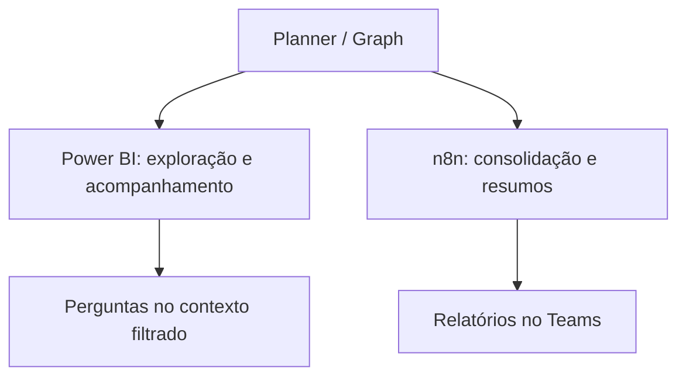

# Complemento com n8n e Teams

O painel oferece leitura interativa e perguntas sobre o contexto do relatório. A automação obtém tarefas e mensagens, calcula indicadores, usa IA e distribui resumos no Teams.

As duas partes compartilham o processo de gestão e as fontes. O fluxo exportado consulta o Graph diretamente: não foi identificada uma etapa obrigatória de leitura do dataset do Power BI.

[Repositório da automação](https://github.com/alosiolemos/n8n-planner-ai-teams-reports).

A versão pública do fluxo está inativa, sem credenciais e com envios desabilitados. A distribuição histórica não foi executada nesta preparação.
