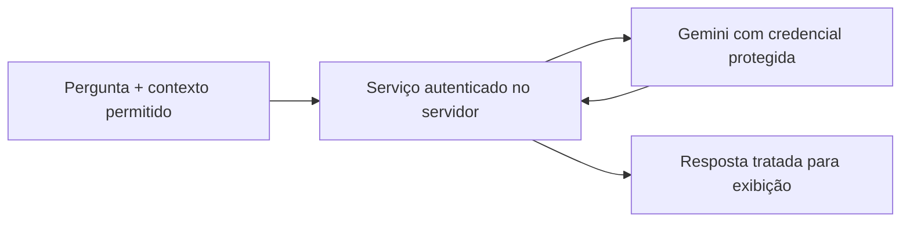

# Interface Gemini dentro do relatório

## Implementação observada

A medida Gemini_Operations_AI reúne indicadores DAX, uma seleção de atividades e um histórico mensal. Ela compõe HTML/JavaScript com campo de pergunta e envia um prompt ao endpoint generateContent do Gemini.

O caminho histórico referencia gemini-2.5-flash. A disponibilidade futura do modelo e a conectividade não foram testadas nesta edição.

## Contexto enviado

O código inclui títulos, board, solicitante, status, categoria, tipo, frente de demanda, datas e trechos de detalhes, além de indicadores e histórico.

A expressão usa TOPN(200), inclusive de forma aninhada, enquanto o texto da interface menciona 100 atividades. A seleção real precisa ser alinhada à interface antes da retomada. TOPN pode incluir empates no limite; não é uma promessa de exatamente 200 linhas.

Há recorte de texto de detalhes em 250 caracteres e uma seleção de até 12 posições mensais conforme a expressão e o contexto. O conteúdo é uma amostra/resumo, não todo o histórico operacional.

## O que a resposta significa

O chat apoia perguntas sobre backlog, produtividade, recorrências e possíveis gargalos. Uma resposta da IA sobre causa raiz é uma hipótese a investigar, não uma conclusão causal comprovada.

O prompt usa o contexto montado para a solicitação. A frase da interface sobre não armazenar contexto não comprova política de retenção do provedor ou de um eventual servidor.

## Credencial retirada

A chave encontrada no original foi substituída por CONFIGURE_SECRET_PRIVATELY. Nenhuma chave real faz parte do repositório.

A [orientação do Google](https://ai.google.dev/gemini-api/docs/api-key) recomenda não expor chaves em código cliente de produção. Colocar a chave em outra variável DAX ou ocultá-la no layout não a protege de quem recebe o conteúdo.

## Arquitetura recomendada para retomada

Esse serviço não foi implementado nesta edição. O arquivo histórico não deve receber uma chave real para uso compartilhado.

## Tratamento da resposta

O JavaScript histórico insere HTML por innerHTML. Pedir tags permitidas no prompt não equivale a sanitizar a resposta.

Antes de uso operacional, implemente validação/escape da pergunta, serialização do contexto e sanitização por lista permitida ou apresentação em texto. Considere também que títulos, comentários e respostas da IA são conteúdo de dados, não instruções confiáveis.

A renderização de script depende da edição do visual, do sandbox e das políticas do ambiente. Não foi validada no Power BI Desktop ou Service nesta publicação.
